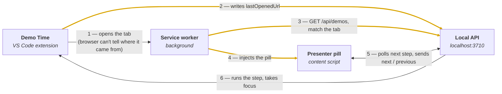

# The Browser Handoff

Build plan for the Demo Time browser extension.

A demo step opens a website. You walk through it. Then you click one control on the page and VS Code
jumps back to the front with the next step already running. This document covers the piece in the
middle.

| | |
| --- | --- |
| **Scope** | One new nx app + one new API field |
| **Base** | [PR #374](https://github.com/estruyf/vscode-demo-time/pull/374) |
| **Tier** | Free, like the Remote Control PWA |
| **Ships to** | Chrome Web Store |
| **Stack** | Extension.js, Manifest V3 |

---

## Six decisions this plan is built on

| Decision | Choice | Why |
| --- | --- | --- |
| **Surface** | A pill injected on the page | Not a popup you have to click open. Your audience sees it — it reads as presenter UI. |
| **Where it appears** | Only tabs Demo Time opened | No pill on everyday browsing. The one choice that needs new work on the VS Code side. |
| **Trigger** | Click, no hotkeys | You have a mouse in hand during a website walkthrough anyway. Skips the `commands` API entirely. |
| **Controls** | Next, previous, jump | Advance, step back, or open the step list to recover from a wrong turn. |
| **Connection** | Auto-detect, manual override | Probe `localhost:3710` first. Settings field stays for ngrok and custom ports. |
| **Security** | Unchanged for now | The API is off by default and bound to localhost. Tokens are a later conversation, not a blocker. |

---

## How the loop closes

> Thick yellow edges are new work. Everything else already exists.

`openWebsite` hands the URL to the OS, so the browser has no idea the tab came from VS Code.
Recording `lastOpenedUrl` is what lets the service worker recognise it a moment later and inject the
pill into that tab and no other.

**Tag by tab id, not URL.** Once the service worker has matched the tab, the pill should survive a
login redirect, an OAuth bounce, and any amount of clicking around inside the site. The tag dies when
the tab does.

---

## What you already have

### Already shipping

- `openWebsite` opens a real browser tab — step one of the loop is done
- `/api/demos` already returns `nextDemo`, so "show me the next action" needs no new endpoint
- `previousEnabled` tells the pill exactly when to grey out the back button
- `?bringToFront=true` already focuses the VS Code window
- `/api/runById` handles jump-to-step over `GET` or `POST`
- `app.use(cors())` means the content script can call all of it directly

### Missing

- Nothing records *which URL* a demo step just opened
- Nothing on the browser side maps a new tab back to a demo
- No content script, so no pill — PR #374 is popup-only today
- The docs for `/api/demos` describe a response the code doesn't return

> [!IMPORTANT]
> **Fix the docs early.** `docs/src/content/docs/references/api.mdx` documents `/api/demos` as
> `{ demoFiles, nextDemo, currentDemoFile }`. `getDemoApiData.ts` actually returns
> `{ nextDemo, demos, currentDemoFile, previousEnabled, slides, clock, settings }`. The PR author
> already reverse-engineered the real shape — anyone else building against this will lose an hour to it.

---

## Build order

Seven phases, each shippable on its own.

### 01 — Teach the API what it opened

`apps/vscode-extension`

- In the `Action.OpenWebsite` branch of `DemoActionDispatcher.ts`, record `{ url: resolvedUrl, at: Date.now() }` after `vscode.open`
- Only for the external-browser path — the `openInVSCode` branch never leaves the editor
- Add `lastOpened` to the payload in `getDemoApiData.ts`
- Ship it on its own: harmless to every existing client, and it unblocks all of the browser work

### 02 — Land the app inside the workspace

`apps/browser-extension`

- Add a `project.json` modelled on `apps/pwa` — `nx:run-commands` wrapping `extension dev` / `build` / `start`
- Delete the standalone `package-lock.json`; the root already globs `apps/*` as a workspace
- Delete `temporary/example.json`
- Add `browser:dev` and `browser:build` to the root scripts, alongside `vscode:dev`

### 03 — Tag the tab

Service worker

- Listen on `chrome.tabs.onCreated` and `onUpdated`; both wake the worker, so no polling is needed here
- Fetch `/api/demos`, and if `lastOpened.at` is within ~10s and the URL matches, store the `tabId` in `chrome.storage.session`
- Clear the tag on `tabs.onRemoved`
- Manifest gains `tabs` and `scripting` on top of the existing `storage` and `<all_urls>`

> A tab opened by an external app has no `openerTabId`, which narrows the candidates — but so does
> every link you click in Slack. The URL match from phase 1 is what makes it exact.

### 04 — The pill

Content script

- `chrome.scripting.executeScript` into the tagged tab only; re-inject on every `onUpdated` complete, since navigation destroys content scripts
- Render into a shadow root so the demo site's CSS can't reach it — you will be demoing sites with aggressive global styles
- Fixed bottom-right: `›` and `‹` plus `nextDemo.title`, with `‹` disabled when `previousEnabled` is false
- Poll `/api/demos` every 1.5s from the page, not the worker; pause while `document.hidden`
- Click calls `fetch('/api/next?bringToFront=true')` — never `chrome.tabs.create`

> [!NOTE]
> **Why the poll lives in the page:** MV3 service workers sleep after 30 seconds, and `chrome.alarms`
> bottoms out at a 30-second period. Neither can keep a live step title on screen.

### 05 — Expand to jump

Content script

- Clicking the title expands the pill into the step list
- Reuse the tree parsing from the PR's `scenes.js` — `children`, `originalLabel`, skip `disabled` — it already matches the real payload
- Selecting a step posts to `/api/runById` with `{ id, bringToFront: true }`
- Collapse on selection, on <kbd>Esc</kbd>, and on click-outside

### 06 — Find VS Code without being told

Settings + worker

- Probe `http://localhost:3710/api/demos` with a short timeout on startup; use it if it answers
- Keep the PR's settings page and `chrome.storage.local` as the manual override for ngrok and custom ports
- When nothing answers, say so plainly in the popup: *Demo Time API not reachable — turn on `demoTime.api.enabled`*
- Never block the pill on a missing config — it just doesn't appear

### 07 — Ship it

Store + docs

- Chrome Web Store developer account, listing copy, screenshots of the pill mid-demo
- Privacy policy is short and true: nothing leaves the machine, the extension only talks to the local API you configure
- Justify `<all_urls>` in the review notes — injection is programmatic and limited to tabs Demo Time opened
- New docs page under `integrations/browser-extension`, cross-linked from Remote Control
- Correct the `/api/demos` response in the API reference while you're there

---

## What to take from PR #374

Arjan Rijsdijk's branch is a working Extension.js scaffold with the design system already applied. The
structure is right; the core interaction is the part that needs rethinking.

| Item | Verdict | Why |
| --- | --- | --- |
| Extension.js + MV3 manifest | ✅ **Keep** | Cross-browser build tooling, sensible dev loop, nothing to argue with. |
| `demotime-custom.css` + `styles/main.css` | ✅ **Keep** | Demo Time visual language already in place, including theming. |
| Settings page + `chrome.storage.local` | ✅ **Keep** | Becomes the manual override once auto-detect lands in phase 6. |
| `scenes.js` payload parsing | ✅ **Keep** | It matches what the API really returns. The docs are what's wrong, not this. |
| `home.js` uses `chrome.tabs.create` | 🔧 **Rework** | Opens a tab full of raw JSON in front of your audience and abandons the page you were demoing. Must be `fetch()`. |
| Popup as the primary surface | 🔧 **Rework** | The pill becomes primary; the popup stays as the fallback and the settings home. |
| Manifest permissions | 🔧 **Rework** | Needs `tabs` and `scripting` for tab tagging and injection. |
| No `project.json` | 🔧 **Rework** | Currently invisible to nx. Model it on `apps/pwa`. |
| `temporary/example.json` | ❌ **Drop** | 5,815 lines of scratch data. |
| `package-lock.json` | ❌ **Drop** | 10,508 lines that fight the workspace's dependency resolution. |

---

## Deliberately out of scope

**API token** — With `cors()` wide open, any site you visit while the API is running can call
`/api/demos` (which returns absolute file paths from your machine) or drive your demo with
`/api/next`. Real, but the API is off by default and localhost-bound. Worth a token eventually; not a
reason to hold this.

**Edge Add-ons** — Same package, second listing. Do it once the Chrome review process is understood.

**Firefox** — Different manifest story and a third review pipeline. Revisit only if people ask.

**Keyboard shortcuts** — The `commands` API is there if clicking turns out to be wrong on stage. Cheap
to add later, and it collides with site shortcuts, so don't add it speculatively.

**In-page automation** — Scripted `click`, `type`, `highlight` and `scroll` as demo steps is the much
bigger version of this idea, and the one where selectors break live. Different project. The pill has
to earn its keep first.

---

Phase 1 is the only change to the VS Code extension and can merge independently. Phases 2–6 all live
in `apps/browser-extension`. Phase 7 is the only one with an external dependency you don't control.
